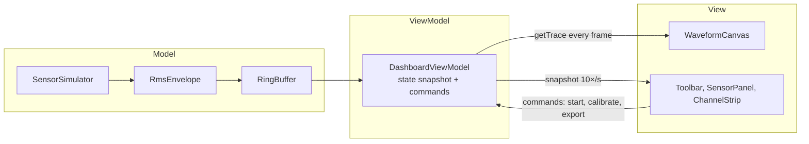

# MyoScope

A real-time dashboard for wearable EMG sensors. MyoScope streams muscle activity
from four body-worn sensors, processes it live, and shows how hard each muscle is
working during an exercise.

> Sensor data is simulated: a subject performing bicep curls at 2,000 samples per
> second per sensor. The simulator sits behind the Model layer, so a real device
> driver could replace it without changing the UI.


## Features
- Live scrolling EMG traces for four muscles with an RMS envelope overlay
- Calibration to each muscle's maximum contraction, so activity reads as % of max
- Automatic rep counting from the biceps signal
- Sensor panel with battery level and signal quality per sensor
- Adjustable time window, show/hide sensors, and CSV export of a session

## Architecture
MyoScope follows the Model-View-ViewModel pattern.



- **Model** holds pure signal logic with no UI code.
- **ViewModel** owns state and exposes commands, similar to `ICommand` and
  `INotifyPropertyChanged` in WPF. `ObservableObject` publishes immutable snapshots.
- **View** components bind with a `useViewModel` hook and never touch the Model.

Raw samples (8,000 per second) bypass React entirely: the canvas reads ViewModel
buffers on each animation frame and draws one min/max line per pixel column.

## Signal pipeline
Raw EMG → moving RMS (100 ms window) → normalization to calibrated maximum → display.

## Run locally
```bash
npm install
npm run dev
```

## Roadmap
Fatigue tracking via median frequency, a 20–450 Hz bandpass filter, simulated
sensor dropout handling, and unit tests for the signal-processing classes.
