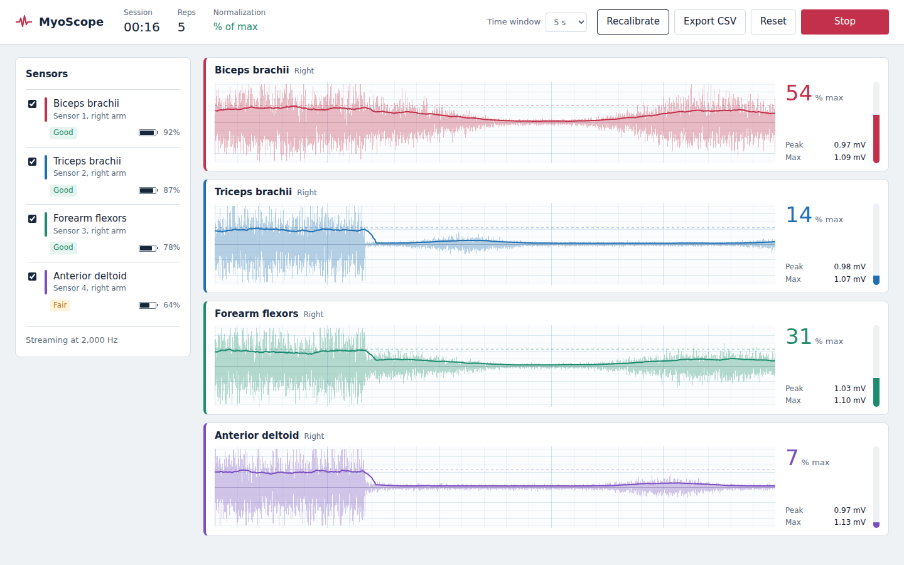
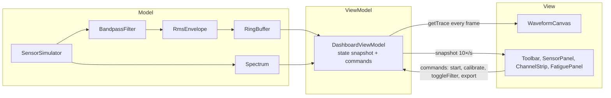

# MyoScope

A real-time dashboard for wearable EMG sensors. MyoScope streams muscle activity
from four body-worn sensors, processes it live, and shows how hard each muscle is
working during an exercise.

**[Live demo](https://aaryapatil113.github.io/myoscope/)**: press Start streaming.

> Sensor data is simulated: a subject performing bicep curls at 2,000 samples per
> second per sensor. The simulator sits behind the Model layer, so a real device
> driver could replace it without changing the UI.



## Features
- Live scrolling EMG traces for four muscles with an RMS envelope overlay
- Calibration to each muscle's maximum contraction, so activity reads as % of max
- Automatic rep counting from the biceps signal
- Fatigue indicator: median frequency of the biceps signal (FFT written from scratch),
  with a trend line and a Fresh / Tiring / Fatigued status
- 20–450 Hz Butterworth bandpass filter, with a toggle to compare raw and filtered signal
- Simulated wireless dropout and reconnect, shown as a greyed trace with a visible data gap
- Sensor panel with battery level, signal quality and connection state per sensor
- Adjustable time window, show/hide sensors, and CSV export of a session

## Architecture
MyoScope follows the Model-View-ViewModel pattern.



- **Model** holds pure signal logic with no UI code.
- **ViewModel** owns state and exposes commands, similar to `ICommand` and
  `INotifyPropertyChanged` in WPF. `ObservableObject` publishes immutable snapshots.
- **View** components bind with a `useViewModel` hook and never touch the Model.

Raw samples (8,000 per second) bypass React entirely: the canvas reads ViewModel
buffers on each animation frame and draws one min/max line per pixel column.

## Signal pipeline
Raw EMG → 20–450 Hz Butterworth bandpass (removes electrode offset, motion artifact and
high-frequency noise) → moving RMS (100 ms window) → normalization to calibrated maximum → display.

In parallel, once per second: the latest 1 s of biceps signal → Hann window → FFT →
median frequency. A falling median frequency means the muscle is fatiguing.

## Run locally
```bash
npm install
npm run dev
```

## Roadmap
Unit tests for the signal-processing classes, keyboard shortcuts and an accessibility
pass, and a styling pass to match the Figma design.
